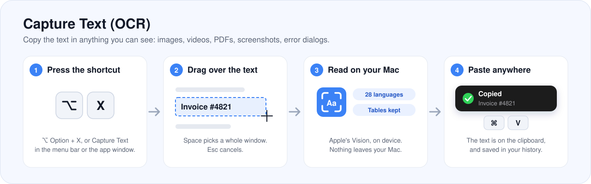
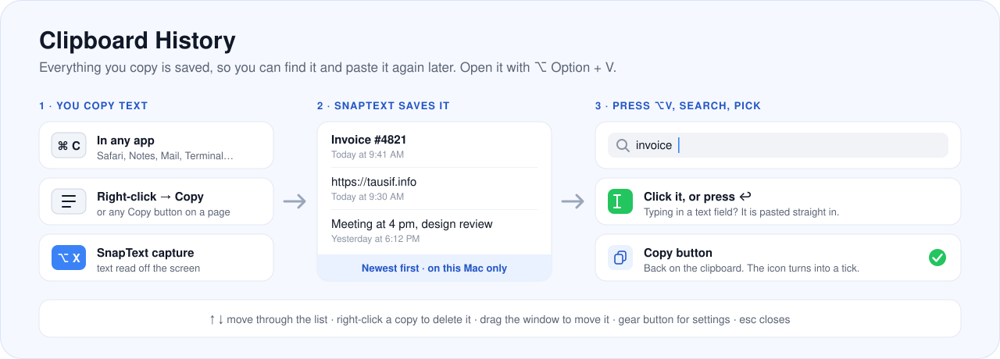
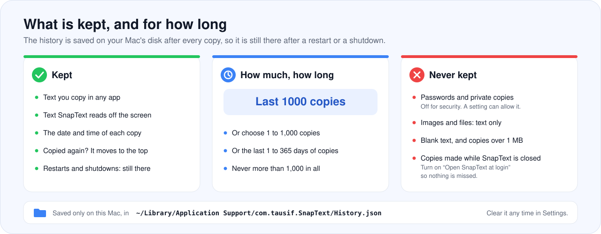
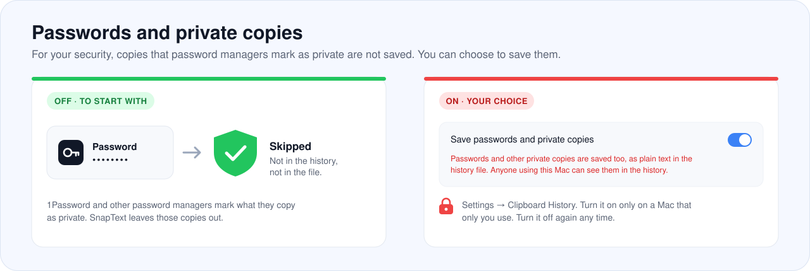
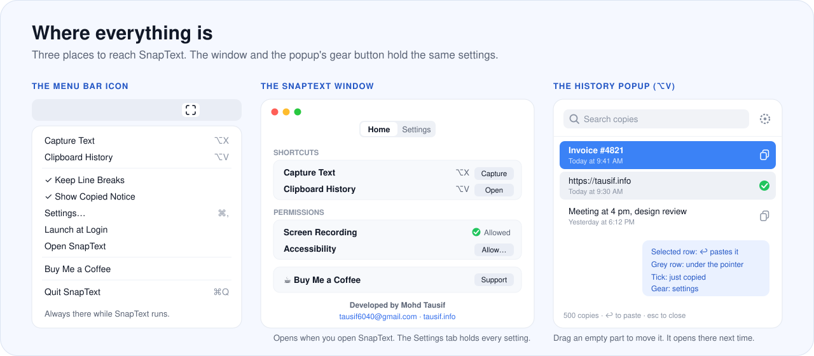

<h1 align="center">
  
</h1>

<p align="center">
  <b>The complete guide to SnapText 2.1</b>
</p>

<p align="center">
  <b>Copy text from anywhere on your Mac's screen</b> - images, videos, PDFs, error dialogs,<br>
  anything you can see but cannot select. 
</p>
<p align="center"><b>Clipboard History</b> - Keeps the text you copy in any app, so you can search it and paste it again later.</p>

<p align="center">
  
  
  
  
  
</p>

<p align="center">
  <a href="#1-snaptext-at-a-glance">At a glance</a> ·
  <a href="#2-capture-text-ocr">Capture Text</a> ·
  <a href="#3-clipboard-history">Clipboard History</a> ·
  <a href="#4-what-is-kept-and-for-how-long">What is kept</a> ·
  <a href="#5-where-everything-is">Where things are</a> ·
  <a href="#6-every-setting">Settings</a> ·
  <a href="#9-questions">Questions</a>
</p>

> This guide explains how to use SnapText. To install it, build it, or read how it works inside, see the
> main [README](README2.md).

## 🆕 New in 2.1: Clipboard History

SnapText now remembers the text you copy in any app, not only what it reads off the screen. Press
<kbd>⌥ Option</kbd> + <kbd>V</kbd> to see your recent copies, search them, and click one to paste it where you
are typing.

- **Saved on your Mac,** so your copies are still there after a restart. [What is kept →](#4-what-is-kept-and-for-how-long)
- **Up to 1,000 copies, or up to 100 days.** Keep the last 500 copies to start with, up to 1,000, or every copy
  from the last 30 days, up to 100 days. [Settings →](#6-every-setting)
- **Passwords stay out,** for your security, unless you choose to save them. [Passwords →](#passwords-and-private-copies)

[Read the full Clipboard History section →](#3-clipboard-history)

## 1. SnapText at a glance

SnapText lives in your Mac's menu bar and does two things:

|     | Feature                | Shortcut                           | What it does                                                                       |
| --- | ---------------------- | ---------------------------------- | ---------------------------------------------------------------------------------- |
| 🎯  | **Capture Text (OCR)** | <kbd>⌥ Option</kbd> + <kbd>X</kbd> | Copies the text in anything you can see on screen, even text you cannot select.    |
| 📋  | **Clipboard History**  | <kbd>⌥ Option</kbd> + <kbd>V</kbd> | Keeps the text you copy in any app, so you can search it and paste it again later. |

The two work together: text you capture goes straight into the history, next to everything else you copied.

Both shortcuts can be changed. See [Changing a shortcut](#changing-a-shortcut).

## 2. Capture Text (OCR)

<p align="center">
  
</p>

OCR means _optical character recognition_: reading text from a picture of it. SnapText uses it to copy text that
your Mac shows but will not let you select, such as text in:

- photos, screenshots and scanned documents
- videos, presentations and screen shares
- PDFs that are images of pages
- error messages, installers and app windows
- websites and apps that block selecting text

### How to capture text

1. Press <kbd>⌥ Option</kbd> + <kbd>X</kbd>. You can also choose **Capture Text** from the SnapText icon in the
   menu bar, or click **Capture** in the SnapText window. The pointer turns into a crosshair.
2. Drag over the text you want.
   - Press <kbd>Space</kbd> to pick a whole window instead, then click it.
   - Press <kbd>Esc</kbd> to cancel.
3. SnapText reads the text and copies it. A small **Copied** notice shows the start of it.
4. Paste it anywhere with <kbd>⌘ Command</kbd> + <kbd>V</kbd>.

The text is also saved in your [clipboard history](#3-clipboard-history), so you can find it again later.

### What it reads well

- **Many languages, detected by themselves.** On macOS 27 that is 28 languages, among them English, Hindi,
  Marathi, Chinese, Japanese, Korean, Arabic and most European languages. You never pick one.
- **Tables stay tables.** A table, or a list of labels and values, is copied row by row with a tab between the
  cells. Paste it into Numbers, Excel or Google Sheets and each value lands in its own cell.
- **Lines stay lines,** if you want them to. Turn off **Keep line breaks** to join everything into one line,
  which suits a sentence that wraps across lines on screen.

### The notices you may see

| Notice                    | What it means                                                                                                                                                                              |
| ------------------------- | ------------------------------------------------------------------------------------------------------------------------------------------------------------------------------------------ |
| ✅ **Copied**             | The text is on the clipboard. Turn this notice off with **Show copied notice**.                                                                                                            |
| ⏳ **Reading text…**      | Recognition is taking a moment. This happens in the first half minute after installing, while macOS prepares its models, and once the first time it meets a new script such as Devanagari. |
| 🔍 **No text found**      | There was no text in the area you selected. Try a larger area, or zoom in first.                                                                                                           |
| ⚠️ **Couldn't read text** | Something went wrong. The notice says what.                                                                                                                                                |

### Permission it needs

Capture Text needs **Screen Recording** permission, because macOS requires it from every app that reads what is
on screen. SnapText looks only at the area you select, only at the moment you select it, and never saves the
picture. Text is recognized on your Mac by Apple's Vision framework: nothing is sent anywhere.

## 3. Clipboard History

<p align="center">
  
</p>

Every time you copy text, the clipboard forgets what was there before. SnapText keeps it, so you can get back
something you copied an hour ago, or last week.

### What goes into the history

**Normal copies.** Anything you copy as text, in any app, the usual way:

- <kbd>⌘ Command</kbd> + <kbd>C</kbd> in Safari, Chrome, Notes, Mail, Word, Slack, Terminal, Xcode or any other app
- **Copy** from a right-click menu or the Edit menu
- the **Copy** buttons on websites, such as those next to code samples or links to share

**SnapText captures.** Text that [Capture Text](#2-capture-text-ocr) reads off the screen.

**What stays out.** Some copies are never saved. See [what is never kept](#never-kept).

You do not have to do anything: SnapText notices each copy by itself, while it is running.

### Opening the history

Press <kbd>⌥ Option</kbd> + <kbd>V</kbd> from any app. You can also choose **Clipboard History** from the menu bar
icon, or click **Open** in the SnapText window.

A small window shows your copies, newest first. Each row shows the start of the text and when you copied it,
such as _Today at 9:41 AM_ or _Yesterday at 6:12 PM_. Hold the pointer over a row to read more of it.

The window does not take over: the app you were typing in stays in front, ready to paste into.

### Finding a copy

- **Type to search.** The list narrows as you type. Searching ignores capitals and accents, so `cafe` finds
  _Café_.
- **Move with the arrow keys.** <kbd>↑</kbd> and <kbd>↓</kbd> move the blue selection, while you keep typing.
- **Clear the search** with <kbd>Esc</kbd>. Press it again to close the window.

### Using a copy

| You do this                                    | What happens                                                                                                                                                                        |
| ---------------------------------------------- | ----------------------------------------------------------------------------------------------------------------------------------------------------------------------------------- |
| **Click a copy**, or press <kbd>↩ Return</kbd> | If you were typing in a text field, the copy is **pasted straight into it**. If not, it goes on the clipboard, ready for <kbd>⌘</kbd> + <kbd>V</kbd>. The window closes either way. |
| **Click the copy button** at the end of a row  | The copy goes on the clipboard and the button turns into a green tick. The window stays open, so you can keep looking.                                                              |
| **Right-click a copy** and choose **Delete**   | That copy is removed from the history.                                                                                                                                              |

Pasting into another app needs **Accessibility** permission. macOS asks for it the first time you pick a copy.
Without it, SnapText still puts the copy on the clipboard, and you paste it yourself.

### Moving the window

Drag any empty part of the history window, such as the space around the search box, to put it anywhere on
screen. It opens in the same place next time. If that place is no longer on a screen, for example after you
unplug a display, it opens in the middle again.

### Closing it

Press <kbd>Esc</kbd>, press <kbd>⌥ Option</kbd> + <kbd>V</kbd> again, or click anywhere outside it.

## 4. What is kept, and for how long

<p align="center">
  
</p>

### It lasts

The history is written to your Mac's disk after every copy. It is still there after you **quit SnapText,
restart, shut down, or update SnapText**. Copies leave the history only when:

- the limit you chose leaves no room for them, as explained below,
- you delete one with a right-click,
- you click **Clear History** in the settings, or
- you [uninstall SnapText](README2.md#uninstall) and remove its data.

### How much is kept

| You choose           | What is kept                                                      | Range         | Starts at |
| -------------------- | ----------------------------------------------------------------- | ------------- | --------- |
| **Number of copies** | The most recent copies. When a new one arrives, the oldest goes.  | 1 to 1,000    | **500**   |
| **Number of days**   | The copies made in the last 30 days to start with, up to 100. Older ones are deleted. | 1 to 100 days | 30        |

Whichever you choose, the history never holds more than **1,000 copies**. Typing a larger number shows a red
note, _You can't save more than 1,000 copies_, and the limit stops at 1,000. In the same way, copies are kept
for **100 days at most**. Typing more days shows _You can't keep more than 100 days_, and the limit stops at 100.

Lowering the limit deletes the copies beyond it straight away. A **Use the Default** button appears whenever the
limit is not the default, to set it back to 500 copies or 30 days.

**Copying the same text again** does not add a second row. The copy moves to the top, with the new time.

### Never kept

- **Passwords and private copies,** unless you choose to save them. See
  [Passwords and private copies](#passwords-and-private-copies).
- **Images and files.** The history is for text only.
- **Blank copies,** made only of spaces or empty lines.
- **Very large copies,** over 1 MB of text, so that the history stays quick to save.
- **Copies made while SnapText is not running.** SnapText can only notice a copy while it is open. Turn on
  **Open SnapText at login** so it is always running.

To stop saving new copies for a while, turn off **Save history**. What is already saved stays until you clear it.

### Passwords and private copies

<p align="center">
  
</p>

Password managers such as 1Password, and some other apps, mark what they copy as **private**. A password copied
there is meant to be pasted once, not remembered.

**For your security, SnapText does not save these copies.** The history is a plain text file, and anyone who
opens the history on your Mac can read it, so a saved password would be easy to find.

If you want them in the history anyway, for example on a Mac only you use:

1. Open **Settings**, from the gear button in the history popup or the **Settings** tab of the SnapText window.
2. Turn on **Save passwords and private copies**, in the Clipboard History group.

A red note under the switch reminds you that passwords are being saved while it is on. Turn it off again at any
time. It stops new private copies from being saved. Ones already saved stay until you delete them with a
right-click or **Clear History**.

> Some apps do not mark their copies as private. Text copied from them is saved like any other copy, whatever
> this setting is.

### Where it is saved

On your Mac only, in one file:

```
~/Library/Application Support/com.tausif.SnapText/History.json
```

SnapText never connects to the internet, so the history never leaves your Mac.

## 5. Where everything is

<p align="center">
  
</p>

### The SnapText window

Open SnapText from **Applications**, **Launchpad** or **Spotlight** to show its window. This works while it is
already running, too. You can also choose **Open SnapText** from the menu bar icon.

**Home** tab:

- **Shortcuts:** both shortcuts, with a **Capture** and an **Open** button.
- **Permissions:** whether Screen Recording and Accessibility are allowed. **Allowed** with a green tick means
  all is well. Otherwise **Allow…** opens the right page of System Settings.
- **Buy Me a Coffee:** the **Support** button opens the support page.
- **Developer:** who made SnapText, with their email and website.

**Settings** tab: [every setting](#6-every-setting).

Close the window with the red button or <kbd>⌘ Command</kbd> + <kbd>W</kbd>. SnapText keeps running in the menu
bar. When SnapText starts at login, it starts quietly in the menu bar without the window.

### The menu bar icon

| Menu item                    | What it does                                                                |
| ---------------------------- | --------------------------------------------------------------------------- |
| **Capture Text**             | Starts a capture.                                                           |
| **Clipboard History**        | Opens the history.                                                          |
| **Keep Line Breaks**         | Turns the setting of the same name on or off.                               |
| **Show Copied Notice**       | Turns the setting of the same name on or off.                               |
| **Settings…** <kbd>⌘ ,</kbd> | Opens the Settings tab of the SnapText window.                              |
| **Launch at Login**          | Turns **Open SnapText at login** on or off.                                 |
| **Open SnapText**            | Opens the SnapText window.                                                  |
| **Buy Me a Coffee**          | Opens the support page in your browser.                                     |
| **Quit SnapText**            | Quits SnapText. Its shortcuts stop working, and copies are no longer saved. |

### The history popup

Its **gear button** shows the same settings as the SnapText window, without leaving the list. In the settings,
the **‹** button goes back to the list and **✕** closes the popup.

## 6. Every setting

The settings are in the **Settings** tab of the SnapText window, and behind the gear button of the history
popup. Changes take effect at once: there is nothing to save.

### Clipboard History

| Setting                               | What it does                                                                                                                                                                                  | Starts as                   |
| ------------------------------------- | --------------------------------------------------------------------------------------------------------------------------------------------------------------------------------------------- | --------------------------- |
| **Shortcut**                          | The keys that open the history.                                                                                                                                                               | <kbd>⌥</kbd> + <kbd>V</kbd> |
| **Save history**                      | Off: new copies are not saved.                                                                                                                                                                | On                          |
| **Paste into text fields**            | On: picking a copy pastes it into the text field you were typing in. Off: it only goes on the clipboard.                                                                                      | On                          |
| **Save passwords and private copies** | On: copies that password managers mark as private, such as passwords, are saved too, as plain text. Off for your security. See [Passwords and private copies](#passwords-and-private-copies). | Off                         |
| **Limit by**                          | **Number of copies** or **Number of days**.                                                                                                                                                   | Number of copies            |
| **Keep the last**                     | How many copies (up to 1,000), or how many days (up to 100).                                                                                                                                                            | 500 copies                  |
| **Popup opacity**                     | How solid the history popup's background is, from 30% to 100%. Lower it to see what is behind, blurred like frosted glass.                                                                    | 100%                        |
| **Clear History**                     | Shows how many copies are saved, and deletes them all. Click it twice to confirm.                                                                                                             |                             |

### Capture Text (OCR)

| Setting                | What it does                                                                          | Starts as                   |
| ---------------------- | ------------------------------------------------------------------------------------- | --------------------------- |
| **Shortcut**           | The keys that start a capture.                                                        | <kbd>⌥</kbd> + <kbd>X</kbd> |
| **Keep line breaks**   | On: the text keeps the lines it has on screen. Off: it is joined into one line.       | On                          |
| **Show copied notice** | On: every copy is confirmed with a notice. Off: only a capture that took a moment is. | On                          |

### General

| Setting                    | What it does                                                                                  | Starts as |
| -------------------------- | --------------------------------------------------------------------------------------------- | --------- |
| **Open SnapText at login** | Starts SnapText in the menu bar whenever you log in, so captures and the history always work. | Off       |

### Changing a shortcut

1. Click the shortcut's button, such as **⌥V**. It changes to **Press Shortcut…**.
2. Press the keys you want, such as <kbd>⌃ Control</kbd> + <kbd>⌥ Option</kbd> + <kbd>V</kbd>.

Press <kbd>Esc</kbd> to keep the current one. A shortcut must:

- include <kbd>⌘</kbd>, <kbd>⌃</kbd> or <kbd>⌥</kbd>, unless it is a function key such as <kbd>F5</kbd>,
- differ from SnapText's other shortcut, and
- be free: if macOS or another app already uses it, SnapText says so, and you can press another.

While SnapText runs, its shortcuts belong to it. With the defaults, <kbd>⌥</kbd> + <kbd>X</kbd> no longer types
`≈` and <kbd>⌥</kbd> + <kbd>V</kbd> no longer types `√`. Pick other shortcuts if you need those characters.

## 7. Permissions

| Permission           | Needed for                                                 | Without it                                                           |
| -------------------- | ---------------------------------------------------------- | -------------------------------------------------------------------- |
| **Screen Recording** | Capture Text                                               | Captures do not work. SnapText explains how to allow it.             |
| **Accessibility**    | Pasting a copy from the history straight into a text field | Picking a copy only puts it on the clipboard. Everything else works. |

Both are allowed in **System Settings → Privacy & Security**. The **Allow…** buttons in the SnapText window open
the right page. SnapText uses Accessibility only when you pick a copy, to check that the app in front has a text
field focused and to press <kbd>⌘</kbd> + <kbd>V</kbd> there.

## 8. Privacy

- **No internet.** SnapText has no account, no analytics and no update check. **Buy Me a Coffee** and the
  developer links only ask your browser to open a page.
- **Captures are not kept.** The selected area is saved to a temporary file just long enough to read it, then
  deleted.
- **The history stays on your Mac,** in one file you can delete at any time.
- **Passwords are skipped,** for your security. Copies that password managers mark as private are saved only if
  you turn on **Save passwords and private copies**, which is off to start with.

## 9. Questions

<details>
<summary><b>Will my copies still be there after I restart or shut down my Mac?</b></summary>

<br>

Yes. The history is saved on disk after every copy, so restarting, shutting down, quitting SnapText or updating
it does not remove anything. Copies leave only when the [limit](#how-much-is-kept) has no room for them, or when
you delete them.

</details>

<details>
<summary><b>Why is something I copied missing from the history?</b></summary>

<br>

- SnapText was not running when you copied it. Turn on **Open SnapText at login**.
- **Save history** was off.
- It was a password or other private copy, an image or a file, blank, or over 1 MB.
- The limit had no room left for it. Raise **Keep the last**.

</details>

<details>
<summary><b>I clicked a copy, but it was not pasted.</b></summary>

<br>

- Check that **Accessibility** shows **Allowed** in the SnapText window.
- Click into the text field before you press <kbd>⌥</kbd> + <kbd>V</kbd>. SnapText pastes only when a text
  field has the focus. Otherwise it puts the copy on the clipboard, so you can paste it with <kbd>⌘</kbd> +
  <kbd>V</kbd>.
- Check that **Paste into text fields** is on.

</details>

<details>
<summary><b>Can SnapText keep more than 1,000 copies?</b></summary>

<br>

No. 1,000 is the most, so that the history stays quick to open and search. 500 are kept to start with.

</details>

<details>
<summary><b>How do I delete everything?</b></summary>

<br>

Open the settings and click **Clear History** twice. To remove SnapText and all its data, follow
[Uninstall](README2.md#uninstall) in the main README.

</details>

<details>
<summary><b>The shortcut does nothing.</b></summary>

<br>

Check that the SnapText icon is in the menu bar. If it is, another app may be using the same keys: choose
another shortcut in the settings. For captures, also check that **Screen Recording** shows **Allowed**.

</details>

## Developer

Made by **Mohd Tausif**.

- Email: [tausif6040@gmail.com](mailto:tausif6040@gmail.com)
- Website: [tausif.info](https://tausif.info)
- Support SnapText: [Buy me a coffee](https://tausif.info/OCRpay)

SnapText is free for personal and noncommercial use, under the
[PolyForm Noncommercial License 1.0.0](LICENSE). See [License](README2.md#license) for what that allows.
