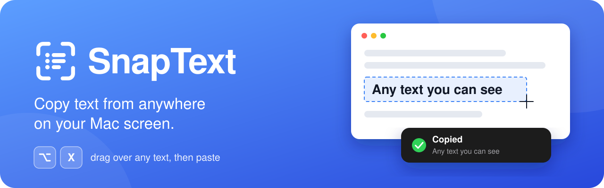
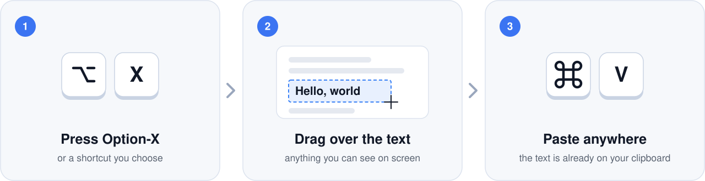
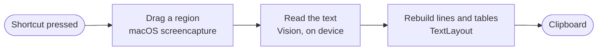

<h1 align="center">
  
</h1>

<p align="center">
  <b>Copy text from anywhere on your Mac's screen</b> — images, videos, PDFs, error dialogs,<br>
  anything you can see but cannot select.
</p>

<p align="center">
  
  
  
  
</p>

<p align="center">
  <a href="#install">Install</a> ·
  <a href="#using-snaptext">Using it</a> ·
  <a href="#troubleshooting">Troubleshooting</a> ·
  <a href="#under-the-hood">Under the hood</a> ·
  <a href="#support">Support</a>
</p>

<br>

<p align="center">
  
</p>

## Features

- 🎯 **Point and copy.** Drag over any part of the screen and the text in it is on your clipboard.
- 🔒 **Private.** Recognition runs on your Mac with Apple's Vision framework. No account, no analytics, no network.
- 🌍 **Many languages, detected automatically.** 28 on macOS 27, including Hindi, Chinese, Japanese and Arabic.
- 📊 **Tables stay tables.** Rows are copied with tabs between the cells, so they paste straight into a spreadsheet.
- ⌨️ **Your shortcut.** <kbd>⌥ Option</kbd> + <kbd>X</kbd> to start with; record any combination you prefer.
- 🪶 **Small.** One icon in the menu bar, an app under 1 MB, about 800 lines of Swift you can read in an evening.
- 💸 **Free and open source**, under the MIT license.

## Install

SnapText needs macOS 13 Ventura or later.

### Option 1: Download the app

1. Download **SnapText.zip** from the [Releases page](../../releases) and unzip it.
2. Drag **SnapText** into your **Applications** folder.
3. Open it. The first time, macOS refuses and says it could not verify the app. SnapText is not notarized by
   Apple, which requires a paid developer account. To open it anyway:

   - **macOS 15 or later:** click **Done**, open **System Settings → Privacy & Security**, scroll down, click
     **Open Anyway** next to the line about SnapText, and confirm with your password or Touch ID.
   - **macOS 13 or 14:** Control-click SnapText, choose **Open**, then click **Open**.

   You only do this once. If macOS says SnapText "is damaged" instead, run this in Terminal and open it again:

   ```sh
   xattr -dr com.apple.quarantine /Applications/SnapText.app
   ```

The download contains code for both Apple silicon and Intel Macs. It has been tested on Apple silicon only.

### Option 2: Build it yourself

You need Swift 6.2 or later. That comes with Xcode 26, or with the Command Line Tools alone: on macOS 26 or
later, run `xcode-select --install`. You never have to open Xcode.

1. Get the source: on GitHub, click the green **Code** button and choose **Download ZIP**, then unzip it.
   If you use Git, clone the repository instead.
2. Open **Terminal**, go to the folder, and run the build script:

   ```sh
   cd path/to/the/folder
   ./build.sh install
   ```

The script builds SnapText, copies it to `/Applications` and opens it. It takes about a minute.

### First launch

1. SnapText says hello and tells you its shortcut. Click **OK**.
2. macOS asks to let SnapText record the screen. Click **Open System Settings**, switch **SnapText** on, and
   choose **Quit & Reopen** when macOS offers it.
3. Press <kbd>⌥ Option</kbd> + <kbd>X</kbd> and drag over some text.

> [!NOTE]
> macOS demands Screen Recording permission from every app that reads what is on the screen. SnapText looks
> only at the area you drag over, and only at the moment you drag over it.

## Using SnapText

1. Press <kbd>⌥ Option</kbd> + <kbd>X</kbd>, or choose **Capture Text** from the SnapText icon in the menu bar.
   The pointer turns into a crosshair.
2. Drag over the text. Press <kbd>Space</kbd> to pick a whole window instead, or <kbd>Esc</kbd> to cancel.
3. Paste it anywhere with <kbd>⌘ Command</kbd> + <kbd>V</kbd>. A copy that happens at once shows nothing; a
   small notice appears only when reading took a moment, when no text was found, or when something went wrong.

### The menu

| Menu item | What it does |
| --- | --- |
| **Capture Text** | Starts a capture, the same as pressing the shortcut. |
| **Keep Line Breaks** | On: the text keeps the lines it has on screen. Off: everything is joined into one line, which suits a sentence that wraps. |
| **Change Shortcut…** | Press the key combination you want, then **Save**. It must include <kbd>⌘</kbd>, <kbd>⌃</kbd> or <kbd>⌥</kbd>, unless it is a function key. |
| **Launch at Login** | Starts SnapText whenever you log in. |
| **Buy Me a Coffee** | Opens the [support page](https://tausif.info/OCRpay) in your browser. |
| **Quit SnapText** | Quits the app and frees its shortcut. |

### Good to know

- **Tables.** A table, or a list of labels and values, is copied row by row with a tab between the cells.
- **The shortcut belongs to SnapText while it runs.** With the default, <kbd>⌥</kbd> + <kbd>X</kbd> no longer types
  `≈` in other apps. Choose another combination if you need that character.
- **The first capture can be slow.** After installing, macOS prepares its text recognition models. SnapText starts
  that when it opens, but a capture made in the first half minute shows "Reading text…" until it is done. The same
  happens once, for about ten seconds, the first time it meets a new script such as Devanagari.

## Languages

SnapText reads every language that Apple's Vision framework supports on your version of macOS, and works out
which one it is looking at by itself. On macOS 27 that is 28 languages:

Arabic · Cantonese · Chinese (Simplified and Traditional) · Czech · Danish · Dutch · English · Finnish · French ·
German · Hindi · Indonesian · Italian · Japanese · Korean · Malay · Marathi · Norwegian · Polish · Portuguese ·
Romanian · Russian · Spanish · Swedish · Thai · Turkish · Ukrainian · Vietnamese

Earlier versions of macOS support fewer.

## Privacy

- **Everything happens on your Mac.** The text is read by Apple's Vision framework, which runs locally.
- **SnapText never connects to the internet.** It has no account, no analytics and no update check.
  *Buy Me a Coffee* only asks your browser to open a web page.
- **Captures are not kept.** The selected area is saved to a temporary file just long enough to read it, then deleted.
- **The result goes to the clipboard**, replacing what was there, and nowhere else.

## Troubleshooting

<details>
<summary><b>SnapText is switched on under Screen Recording, but it still says it needs permission</b></summary>

<br>

This happens after SnapText has been rebuilt. macOS ties the permission to the app's code signature, and
`build.sh` signs with an ad hoc signature that changes with every build. macOS then shows SnapText as allowed
but refuses it, and does not ask again.

Clear the old entry, then open SnapText and grant the permission once more:

```sh
tccutil reset ScreenCapture com.tausif.SnapText
```

To keep the permission across rebuilds, see [Signing](#signing).

</details>

<details>
<summary><b>Nothing happens when I press the shortcut</b></summary>

<br>

- Check that SnapText is running: its icon should be in the menu bar.
- Another app may be using the same combination. Choose a different one under **Change Shortcut…**.
- A combination that macOS itself uses, such as <kbd>⌘</kbd> + <kbd>Space</kbd> for Spotlight, keeps doing what
  macOS uses it for. Pick one that is free.

</details>

<details>
<summary><b>"Reading text…" stays on screen for a long time</b></summary>

<br>

That is macOS preparing its text recognition models, which it does once after SnapText is installed or rebuilt
(up to half a minute) and once for each new script it reads (about ten seconds). After that, a capture takes a
fraction of a second.

</details>

<details>
<summary><b>It says "No text found", but the text is clearly there</b></summary>

<br>

Try selecting a slightly larger area. If clear text keeps coming back empty, quit SnapText, delete the folder
`~/Library/Caches/com.tausif.SnapText` and open SnapText again. That makes macOS rebuild its recognition
models, which is what cured the problem when it appeared during development.

</details>

<details>
<summary><b>The copied text ends with "…"</b></summary>

<br>

SnapText reads what is on the screen. When an app or a website shortens a long label to "Orient Cables (India) I…",
the missing letters are not drawn anywhere, so there is nothing to read. Recovering them is planned: see the
[roadmap](#roadmap).

</details>

<details>
<summary><b>A letter is missing at the start of a column</b></summary>

<br>

When text sits side by side in columns, Vision occasionally drops a letter where a column begins. Selecting one
column at a time avoids it.

</details>

## Uninstall

1. Quit SnapText from its menu, and turn off **Launch at Login** first if you had it on.
2. Move `/Applications/SnapText.app` to the Trash.
3. To remove every trace, also run:

   ```sh
   defaults delete com.tausif.SnapText
   rm -rf ~/Library/Caches/com.tausif.SnapText
   tccutil reset ScreenCapture com.tausif.SnapText
   ```

## Under the hood



- **Selection** uses macOS's own `screencapture` tool. That gives the crosshair every Mac user knows, works over
  menus and full-screen apps, and never takes focus away from the app you are working in.
- **Recognition** is Vision's `VNRecognizeTextRequest` at its accurate level, with automatic language detection.
  It runs off the main thread, and is warmed up when the app opens.
- **Layout.** Vision reads side-by-side text one column at a time. That suits columns of prose but breaks a table
  into all of its first column followed by all of its second, so `TextLayout` puts tables back together row by row.
- **The shortcut** is a Carbon hot key, which works system-wide without Accessibility permission.

| Path | What it holds |
| --- | --- |
| `Sources/SnapText/main.swift` | Starts the app |
| `Sources/SnapText/AppDelegate.swift` | The menu bar item, its menu, and the capture → recognize → copy flow |
| `Sources/SnapText/ScreenCapture.swift` | Region selection and the Screen Recording permission |
| `Sources/SnapText/TextRecognizer.swift` | Text recognition with Vision |
| `Sources/SnapText/TextLayout.swift` | Turns recognized fragments into lines, and tables into rows |
| `Sources/SnapText/GlobalHotKey.swift`, `Shortcut.swift` | The system-wide shortcut |
| `Sources/SnapText/ShortcutRecorder.swift` | The dialog that records a new shortcut |
| `Sources/SnapText/HUD.swift` | The notice shown for slow captures, missing text and errors |
| `Sources/SnapText/Preferences.swift` | Settings that persist between launches |
| `Tests/SnapTextTests/` | Tests for layout, shortcuts and recognition |
| `Resources/` | `Info.plist` and the app icon |
| `Scripts/make-icon.swift` | Regenerates `Resources/AppIcon.icns` |
| `build.sh` | Builds, installs, packages and tests the app |
| `docs/install-note.txt` | The note that goes into the zip, on how to open the app |
| `docs/images/` | The graphics in this README |

## Building and testing

SnapText is a Swift package. `build.sh` wraps `swift build` and assembles the `.app` bundle around the result.

```sh
./build.sh            # builds build/SnapText.app
./build.sh install    # builds, copies it to /Applications and opens it
./build.sh package    # builds for Apple silicon and Intel, and zips it as build/SnapText.zip
./build.sh test       # runs the tests
```

`package` makes the zip that goes on the Releases page: the app, plus `docs/install-note.txt` as a note on how
to open it.

The recognition tests run Vision for real, so the first test run takes a little under a minute while macOS
prepares its models. Later runs take under a second.

### Signing

Screen Recording permission is tied to the app's code signature. By default `build.sh` signs ad hoc, and an ad
hoc signature changes with every build, so each rebuild needs the permission granted again
(see [Troubleshooting](#troubleshooting)).

If you have a signing certificate in your keychain, use it and the permission survives rebuilds:

```sh
SIGN_IDENTITY="Apple Development" ./build.sh install
```

### The icon

The app icon is drawn in code. After changing `Scripts/make-icon.swift`, regenerate it from the project folder:

```sh
swift Scripts/make-icon.swift
```

<!-- ## Roadmap

- [ ] **Version 2: read the text behind a "…".** When an app or website shortens a label, ask that app for the
      full text through the macOS Accessibility API, and copy that instead. -->

## Contributing

Bug reports, ideas and pull requests are welcome. Please [open an issue](../../issues) first for anything
larger than a small fix, and run `./build.sh test` before sending a pull request.

## Support

SnapText is free. If it saves you time, you can help cover the cost of keeping it going:

<p>
  <a href="https://tausif.info/OCRpay">
    
  </a>
</p>

## License

SnapText is released under the [MIT License](LICENSE).

## Developer

Made by **Tausif**.

- Website: [tausif.info](https://tausif.info)
- Bugs and feature requests: [open an issue](../../issues)
