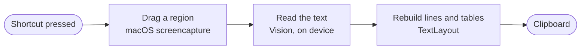

<h1 align="center">
  
</h1>

<p align="center">
  <b>Copy text from anywhere on your Mac's screen</b> — images, videos, PDFs, error dialogs,<br>
  anything you can see but cannot select. <b>Then find it again</b> in your clipboard history.
</p>

<p align="center">
  
  
  
  
  
</p>

<p align="center">
  <a href="README.md"><b>Full guide</b></a> ·
  <a href="#whats-new-in-21">What's new</a> ·
  <a href="#install">Install</a> ·
  <a href="#using-snaptext">Using it</a> ·
  <a href="#troubleshooting">Troubleshooting</a> ·
  <a href="#under-the-hood">Under the hood</a> ·
  <a href="#building-and-testing">Building</a> ·
  <a href="#support">Support</a>
</p>

<br>

<p align="center">
  
</p>

## Features

- 🎯 **Point and copy.** Drag over any part of the screen and the text in it is on your clipboard.
- 🔒 **Private.** Recognition runs on your Mac with Apple's Vision framework. No account, no analytics, no network.
- 🌍 **Many languages, detected automatically.** 28 on macOS 27, including Hindi, Chinese, Japanese and Arabic.
- 📊 **Tables stay tables.** Rows are copied with tabs between the cells, so they paste straight into a spreadsheet.
- 📋 **Clipboard history.** <kbd>⌥ Option</kbd> + <kbd>V</kbd> shows what you copied recently, up to 1,000 copies,
  with the date and time of each and a search box to find one again. Click one to paste it where you are typing.
- 🔐 **Passwords stay out.** Copies that password managers mark as private are never saved, unless you turn
  that on in the settings.
- ⌨️ **Your shortcuts.** <kbd>⌥ Option</kbd> + <kbd>X</kbd> and <kbd>⌥ Option</kbd> + <kbd>V</kbd> to start with;
  record any combinations you prefer.
- 🪟 **Everything in one window.** Open SnapText to see its shortcuts, the permissions it has, and every setting.
- 🪶 **Small.** One icon in the menu bar, an app under 1 MB, about 2,500 lines of Swift you can read in an evening.
- 💸 **Free for personal and noncommercial use**, with its source open to read, under the
  [PolyForm Noncommercial License](#license).

## What's new in 2.1

For every feature explained end to end, with pictures, read the [full guide](README.md).

- **Clipboard history.** SnapText remembers the text you copy in any app, not only the text it reads off the
  screen. Press <kbd>⌥ Option</kbd> + <kbd>V</kbd> to see it, with the date and time of each copy.
  - **Search** as you type, and move through the list with <kbd>↑</kbd> and <kbd>↓</kbd>.
  - **Paste straight in.** Pick a copy while you are typing in a text field, and it is pasted there.
  - **Copy button** on every row, which turns into a tick once the copy is on the clipboard.
  - **Keep what you want:** the last 500 copies to start with, up to 1,000, or the copies from the last so many
    days. It is saved on your Mac, so it survives a restart.
  - **Move the window** anywhere on screen by dragging an empty part of it. It opens there next time.
  - **Glass background.** A **Popup opacity** slider, from 30% to 100%, lets what is behind show through, blurred.
- **Passwords stay out, for your security.** Copies that password managers mark as private are not saved. A new
  setting, **Save passwords and private copies**, saves them too. It is off to start with, and shows a red
  warning while it is on.
- **The SnapText window.** Opening SnapText shows a window with a **Home** tab, which lists both shortcuts and the
  permissions SnapText has, and a **Settings** tab, which holds every setting.
- **New settings,** in three groups: Clipboard History, Capture Text (OCR) and General. The same settings are also
  behind the gear button in the history window.
- **Both shortcuts can be changed** right in the settings: click one and press the new combination.

## Install

SnapText needs macOS 13 Ventura or later.

### Option 1: Download the app

1. Download **SnapText.zip** from the [Releases page](../../releases) and unzip it.
2. Drag **SnapText** into your **Applications** folder.
3. Open it. The first time, macOS refuses and says it could not verify the app. SnapText is not notarized by
   Apple, which requires a paid developer account. To open it anyway:

   - **macOS 15 or later:** click **Done**, open **System Settings → Privacy & Security**, scroll down, click
     **Open Anyway** next to the line about SnapText, and confirm with your password or Touch ID.
   - **macOS 13 or 14:** Control-click SnapText, choose **Open**, then click **Open**.

   You only do this once. If macOS says SnapText "is damaged" instead, run this in Terminal and open it again:

   ```sh
   xattr -dr com.apple.quarantine /Applications/SnapText.app
   ```

The download contains code for both Apple silicon and Intel Macs. It has been tested on Apple silicon only.

### Option 2: Build it yourself

You need Swift 6.2 or later. That comes with Xcode 26, or with the Command Line Tools alone: on macOS 26 or
later, run `xcode-select --install`. You never have to open Xcode.

1. Get the source: on GitHub, click the green **Code** button and choose **Download ZIP**, then unzip it.
   If you use Git, clone the repository instead.
2. Open **Terminal**, go to the folder, and run the build command:

   ```sh
   cd path/to/the/folder
   ./build.sh install
   ```

This builds SnapText, copies it to `/Applications` and opens it. It takes about a minute. Run the same command
again whenever you update the source. For the other commands, such as building without installing or running
the tests, see [Building and testing](#building-and-testing).

### First launch

1. SnapText opens its window, which shows its shortcuts and the permissions it has.
2. macOS asks to let SnapText record the screen. Click **Open System Settings**, switch **SnapText** on, and
   choose **Quit & Reopen** when macOS offers it.
3. Press <kbd>⌥ Option</kbd> + <kbd>X</kbd> and drag over some text.

> [!NOTE]
> macOS demands Screen Recording permission from every app that reads what is on the screen. SnapText looks
> only at the area you drag over, and only at the moment you drag over it.

## Using SnapText

1. Press <kbd>⌥ Option</kbd> + <kbd>X</kbd>, or choose **Capture Text** from the SnapText icon in the menu bar.
   The pointer turns into a crosshair.
2. Drag over the text. Press <kbd>Space</kbd> to pick a whole window instead, or <kbd>Esc</kbd> to cancel.
3. Paste it anywhere with <kbd>⌘ Command</kbd> + <kbd>V</kbd>. A small notice confirms each copy, and also
   appears when no text was found or when something went wrong.

### Clipboard history

SnapText remembers the text you copy in any app, not only the text it reads off the screen.

1. Press <kbd>⌥ Option</kbd> + <kbd>V</kbd>, or choose **Clipboard History** from the menu bar. A small window
   lists your copies, newest first, each with the date and time it was copied.
2. Type to search. <kbd>↑</kbd> and <kbd>↓</kbd> move through the list.
3. Press <kbd>Return</kbd> or click a copy to use it. If you were typing in a text field when you opened the
   history, the copy is pasted straight into it. Otherwise it goes on the clipboard, ready to paste with
   <kbd>⌘ Command</kbd> + <kbd>V</kbd>. <kbd>Esc</kbd> or a click elsewhere closes the window.

The copy button at the end of each row puts that copy on the clipboard and turns into a tick, leaving the window
open. Right-click a copy to delete it.

To move the window, drag an empty part of it, such as the space around the search field. It opens in the same
place next time, as long as that place is still on a screen.

> [!NOTE]
> Pasting into another app needs Accessibility permission, which macOS asks for the first time you pick a copy.
> Without it, SnapText only puts the copy on the clipboard. You can allow it later from the settings, or in
> **System Settings → Privacy & Security → Accessibility**.

Copying the same text again moves it to the top instead of listing it twice. Copies larger than 1 MB are not saved.

### Settings

Every setting is in the **Settings** tab of the [SnapText window](#the-snaptext-window). **Settings…** in the menu
bar (<kbd>⌘</kbd> + <kbd>,</kbd>) opens it there, and the gear button in the history window shows the same
settings without leaving the list. The settings are in three groups.

**Clipboard History**

| Setting | What it does |
| --- | --- |
| **Shortcut** | Click it, then press the combination that should open the history. <kbd>Esc</kbd> keeps the current one. |
| **Save history** | Off: new copies are not saved. What is already saved stays until you clear it. |
| **Paste into text fields** | On: picking a copy pastes it into the text field you were typing in. Off: it only goes on the clipboard. |
| **Save passwords and private copies** | On: copies that password managers mark as private, such as passwords, are saved too, as plain text. Off to start with, for your security. |
| **Limit by** | **Number of copies** keeps the most recent ones, 1 to 1,000, and 500 to start with. **Number of days** keeps those from the last 1 to 365 days. Either way, no more than 1,000 are kept, and typing a larger number says so. When the limit is not the default, a button sets it back to 500 copies or 30 days. |
| **Popup opacity** | How solid the popup's background is, 30% to 100%. Lower it for a frosted glass look, with what is behind blurred. |
| **Clear History** | Shows how many copies are saved, and deletes them all. Click it twice to confirm. |

**Capture Text (OCR)**

| Setting | What it does |
| --- | --- |
| **Shortcut** | Click it, then press the combination that should start a capture. |
| **Keep line breaks** | On: the text keeps the lines it has on screen. Off: everything is joined into one line, which suits a sentence that wraps. |
| **Show copied notice** | On: every copy is confirmed with a notice. Off: a copy that happens at once shows nothing, and only one that took a moment is confirmed. Notices for missing text and errors appear either way. |

**General**

| Setting | What it does |
| --- | --- |
| **Open SnapText at login** | Starts SnapText, in the menu bar only, whenever you log in. |

A shortcut must include <kbd>⌘</kbd>, <kbd>⌃</kbd> or <kbd>⌥</kbd>, unless it is a function key, and the two
shortcuts must differ.

### The SnapText window

Opening SnapText from Applications, Launchpad or Spotlight shows its window, even while it is already running.
Closing it leaves SnapText running in the menu bar. When SnapText starts at login, it starts in the menu bar only.

- **Home** lists both shortcuts with a button for each, and shows whether Screen Recording and Accessibility are
  allowed, with a button to allow each one that is not. Below that are **Buy Me a Coffee** and who made SnapText.
- **Settings** holds [every setting](#settings).

### The menu

| Menu item | What it does |
| --- | --- |
| **Capture Text** | Starts a capture, the same as pressing the shortcut. |
| **Clipboard History** | Opens the clipboard history, the same as pressing its shortcut. |
| **Keep Line Breaks** | The same as **Keep line breaks** in the [settings](#settings). |
| **Show Copied Notice** | The same as **Show copied notice** in the [settings](#settings). |
| **Settings…** | Opens the [settings](#settings) in the SnapText window. |
| **Open SnapText** | Opens the SnapText window. |
| **Launch at Login** | The same as **Open SnapText at login** in the [settings](#settings). |
| **Buy Me a Coffee** | Opens the [support page](https://tausif.info/OCRpay) in your browser. |
| **Quit SnapText** | Quits the app and frees its shortcuts. |

### Good to know

- **Tables.** A table, or a list of labels and values, is copied row by row with a tab between the cells.
- **The shortcuts belong to SnapText while it runs.** With the default, <kbd>⌥</kbd> + <kbd>X</kbd> no longer types
  `≈` in other apps. Choose another combination if you need that character. Likewise, <kbd>⌥</kbd> + <kbd>V</kbd>
  opens the clipboard history instead of typing `√`.
- **The first capture can be slow.** After installing, macOS prepares its text recognition models. SnapText starts
  that when it opens, but a capture made in the first half minute shows "Reading text…" until it is done. The same
  happens once, for about ten seconds, the first time it meets a new script such as Devanagari.

## Languages

SnapText reads every language that Apple's Vision framework supports on your version of macOS, and works out
which one it is looking at by itself. On macOS 27 that is 28 languages:

Arabic · Cantonese · Chinese (Simplified and Traditional) · Czech · Danish · Dutch · English · Finnish · French ·
German · Hindi · Indonesian · Italian · Japanese · Korean · Malay · Marathi · Norwegian · Polish · Portuguese ·
Romanian · Russian · Spanish · Swedish · Thai · Turkish · Ukrainian · Vietnamese

Earlier versions of macOS support fewer.

## Privacy

- **Everything happens on your Mac.** The text is read by Apple's Vision framework, which runs locally.
- **SnapText never connects to the internet.** It has no account, no analytics and no update check.
  *Buy Me a Coffee* only asks your browser to open a web page.
- **Captures are not kept.** The selected area is saved to a temporary file just long enough to read it, then deleted.
- **The result goes to the clipboard**, replacing what was there, and nowhere else.
- **Accessibility permission**, if you give it, is used only when you pick a copy from the history: to check that
  the app in front has a text field focused, and to press <kbd>⌘</kbd> + <kbd>V</kbd> there.
- **The clipboard history stays on your Mac**, in `~/Library/Application Support/com.tausif.SnapText/History.json`.
  Only text is saved. Turn the history off, or clear it, in the settings.
- **Passwords are not saved.** Copies that password managers mark as private are skipped, for your security.
  The setting **Save passwords and private copies** saves them too. It is off to start with.

## Troubleshooting

<details>
<summary><b>SnapText is switched on under Screen Recording, but it still says it needs permission</b></summary>

<br>

This happens after SnapText has been rebuilt or updated. macOS ties the permission to the app's code signature,
and a build signed ad hoc gets a new signature every time. macOS then shows SnapText as allowed but refuses it,
and does not ask again.

Clear the old entry, then open SnapText and grant the permission once more. In System Settings, select SnapText
in the Screen Recording list and remove it with the **−** button, or run:

```sh
tccutil reset ScreenCapture com.tausif.SnapText
```

To keep the permission across rebuilds, see [Signing](#signing).

</details>

<details>
<summary><b>Nothing happens when I press the shortcut</b></summary>

<br>

- Check that SnapText is running: its icon should be in the menu bar.
- Another app may be using the same combination. Choose a different one under **Settings…**.
- A combination that macOS itself uses, such as <kbd>⌘</kbd> + <kbd>Space</kbd> for Spotlight, keeps doing what
  macOS uses it for. Pick one that is free.

</details>

<details>
<summary><b>"Reading text…" stays on screen for a long time</b></summary>

<br>

That is macOS preparing its text recognition models, which it does once after SnapText is installed or rebuilt
(up to half a minute) and once for each new script it reads (about ten seconds). After that, a capture takes a
fraction of a second.

</details>

<details>
<summary><b>It says "No text found", but the text is clearly there</b></summary>

<br>

Try selecting a slightly larger area. If clear text keeps coming back empty, quit SnapText, delete the folder
`~/Library/Caches/com.tausif.SnapText` and open SnapText again. That makes macOS rebuild its recognition
models, which is what cured the problem when it appeared during development.

</details>

<details>
<summary><b>The copied text ends with "…"</b></summary>

<br>

SnapText reads what is on the screen. When an app or a website shortens a long label to "Orient Cables (India) I…",
the missing letters are not drawn anywhere, so there is nothing to read. Recovering them is planned: see the
[roadmap](#roadmap).

</details>

<details>
<summary><b>A letter is missing at the start of a column</b></summary>

<br>

When text sits side by side in columns, Vision occasionally drops a letter where a column begins. Selecting one
column at a time avoids it.

</details>

## Uninstall

1. Quit SnapText from its menu, and turn off **Launch at Login** first if you had it on.
2. Move `/Applications/SnapText.app` to the Trash.
3. To remove every trace, also run:

   ```sh
   defaults delete com.tausif.SnapText
   rm -rf ~/Library/Caches/com.tausif.SnapText
   rm -rf ~/Library/Application\ Support/com.tausif.SnapText
   tccutil reset ScreenCapture com.tausif.SnapText
   tccutil reset Accessibility com.tausif.SnapText
   ```

## Under the hood



- **Selection** uses macOS's own `screencapture` tool. That gives the crosshair every Mac user knows, works over
  menus and full-screen apps, and never takes focus away from the app you are working in.
- **Recognition** is Vision's `VNRecognizeTextRequest` at its accurate level, with automatic language detection.
  It runs off the main thread, and is warmed up when the app opens.
- **Layout.** Vision reads side-by-side text one column at a time. That suits columns of prose but breaks a table
  into all of its first column followed by all of its second, so `TextLayout` puts tables back together row by row.
- **The shortcuts** are Carbon hot keys, which work system-wide without Accessibility permission.
- **Pasting from the history** asks the Accessibility API whether the app in front has a text field focused, and
  if so posts <kbd>⌘</kbd> + <kbd>V</kbd> to it with a Core Graphics event.
- **Clipboard history.** macOS announces no clipboard changes, so `ClipboardWatcher` looks at the clipboard's change
  count twice a second and saves any new text. The history window is a panel that takes key presses without
  activating SnapText, so the app you were in stays in front, ready to paste into.

| Path | What it holds |
| --- | --- |
| `Sources/SnapText/main.swift` | Starts the app |
| `Sources/SnapText/AppDelegate.swift` | The menu bar item, its menu, and the capture → recognize → copy flow |
| `Sources/SnapText/ScreenCapture.swift` | Region selection and the Screen Recording permission |
| `Sources/SnapText/TextRecognizer.swift` | Text recognition with Vision |
| `Sources/SnapText/TextLayout.swift` | Turns recognized fragments into lines, and tables into rows |
| `Sources/SnapText/GlobalHotKey.swift`, `Shortcut.swift` | The system-wide shortcuts |
| `Sources/SnapText/ShortcutField.swift` | The button in the settings that records a new shortcut |
| `Sources/SnapText/ClipboardHistory.swift` | The saved copies, their limit, and search |
| `Sources/SnapText/ClipboardWatcher.swift` | Notices new copies in any app |
| `Sources/SnapText/HistoryPanel.swift` | The clipboard history window |
| `Sources/SnapText/Paster.swift` | Pastes a copy from the history into the app in front |
| `Sources/SnapText/MainWindow.swift` | The window that opens when you open SnapText, with its Home and Settings tabs |
| `Sources/SnapText/SettingsView.swift` | Every setting, shown in the SnapText window and behind the history's gear button |
| `Sources/SnapText/LaunchAtLogin.swift` | Opening SnapText at login |
| `Sources/SnapText/Constants.swift` | The developer's details, and every link and web address the app opens |
| `Sources/SnapText/HUD.swift` | The notice shown for copies, slow captures, missing text and errors |
| `Sources/SnapText/Preferences.swift` | Settings that persist between launches |
| `Tests/SnapTextTests/` | Tests for layout, shortcuts, recognition and the clipboard history |
| `Resources/` | `Info.plist` and the app icon |
| `Scripts/make-icon.swift` | Regenerates `Resources/AppIcon.icns` |
| `build.sh` | Builds, installs, packages and tests the app |
| `docs/install-note.txt` | The note that goes into the zip and the disk image, on how to open the app |
| `docs/images/` | The graphics in this README |

## Building and testing

SnapText is a Swift package. You build it with one script, `build.sh`, in the project folder. It runs
`swift build` for you and wraps the result in a proper `SnapText.app`.

### What you need

- macOS 13 or later
- Swift 6.2 or later, from Xcode 26 or from the Command Line Tools. On macOS 26 or later, install the Command Line
  Tools with:

  ```sh
  xcode-select --install
  ```

  Check that it worked with `swift --version`.

### Build and run, step by step

1. Open **Terminal** and go to the project folder:

   ```sh
   cd path/to/SnapText
   ```

2. Build SnapText, install it in `/Applications` and open it:

   ```sh
   ./build.sh install
   ```

   This is the command you will use most. Run it again every time you change the code or download a new version.
   If SnapText is already running, the script quits it first.

   Type the command exactly, starting with a dot: `./build.sh` runs the script in this folder, while `/build.sh`
   looks for it at the top of the disk and fails with `no such file or directory`. The same error means you are
   in the wrong folder: run `ls` and check that `build.sh` is listed.

3. If macOS says `permission denied`, make the script executable once and try again:

   ```sh
   chmod +x build.sh
   ```

### Every command

Run these from the project folder.

| Command | What it does | Where the result goes |
| --- | --- | --- |
| `./build.sh` | Builds the app without installing it | `build/SnapText.app` |
| `./build.sh install` | Builds the app, replaces the copy in Applications and opens it | `/Applications/SnapText.app` |
| `./build.sh test` | Runs all the tests | Results in Terminal |
| `./build.sh package` | Builds for Apple silicon and Intel and zips it for sharing | `build/SnapText.zip` |
| `./build.sh dmg` | The same as `package`, but as a disk image | `build/SnapText.dmg` |

### Finding the app after a build

- **After `./build.sh install`** there is nothing to do: SnapText is already in your Applications folder and
  running, with its icon in the menu bar. Later, open it from Launchpad, Spotlight or Finder → Applications.
- **After `./build.sh`** the app is inside the project folder. Run `open build` to show it in Finder, then drag
  **SnapText.app** into **Applications** to install it.
- **To install it on another Mac**, make a disk image or a zip, as the next section shows, and send that file.

### Making a DMG or ZIP to share

Run one of these from the project folder:

```sh
./build.sh dmg       # makes build/SnapText.dmg
./build.sh package   # makes build/SnapText.zip
```

Both build SnapText for Apple silicon and Intel Macs, and include `docs/install-note.txt` as a note on how to open
the app. Run `open build` to see the file in Finder.

- **The DMG** is the easiest to install from. Opening it shows a window with the app, an arrow and a link to
  Applications, so installing is a single drag.
- **The ZIP** is what goes on the Releases page. Unzip it, then drag **SnapText** into **Applications**.

On the other Mac, open SnapText the way [Option 1: Download the app](#option-1-download-the-app) describes, since
macOS blocks it the first time.

The recognition tests run Vision for real, so the first test run takes a little under a minute while macOS
prepares its models. Later runs take under a second.

### Signing

Screen Recording permission is tied to the app's code signature. When your keychain has an Apple Development
certificate (Xcode creates one when you sign in with an Apple ID), `build.sh` signs with it, and the permission
survives rebuilds. Without one it signs ad hoc, and an ad hoc signature changes with every build, so each
rebuild needs the permission granted again (see [Troubleshooting](#troubleshooting)).

To sign with a different certificate, or to force an ad hoc signature:

```sh
SIGN_IDENTITY="Developer ID Application" ./build.sh install
SIGN_IDENTITY=- ./build.sh install
```

### The icon

The app icon is drawn in code. After changing `Scripts/make-icon.swift`, regenerate it from the project folder:

```sh
swift Scripts/make-icon.swift
```

### The disk image window

The window that `./build.sh dmg` sets up comes from two files in `Resources/`: `DMGBackground.tiff`, the picture
with the arrow, and `DMGLayout.DS_Store`, where the icons go. To change it:

```sh
swift Scripts/make-dmg-background.swift   # redraws the background
Scripts/make-dmg-layout.sh                # records where the icons go
./build.sh dmg
```

`make-dmg-layout.sh` has Finder lay out a scratch disk image, so the first time macOS asks to let Terminal control
Finder. Change the icon positions in both scripts together, since the arrow is drawn between them.

<!-- ## Roadmap

- [ ] **Version 2: read the text behind a "…".** When an app or website shortens a label, ask that app for the
      full text through the macOS Accessibility API, and copy that instead. -->

## Contributing

Bug reports, ideas and pull requests are welcome. Please [open an issue](../../issues) first for anything
larger than a small fix, and run `./build.sh test` before sending a pull request.

## Support

SnapText is free. If it saves you time, you can help cover the cost of keeping it going:

<p>
  <a href="https://tausif.info/OCRpay">
    
  </a>
</p>

## License

SnapText is released under the [PolyForm Noncommercial License 1.0.0](LICENSE).
Copyright (c) 2026 Tausif.

- **You may** use it, read and change its code, and share it, with or without your changes, for any
  noncommercial purpose: personal use, study, hobby projects, and use by charities, schools, public research,
  and government bodies.
- **You may not** use it, or anything made from it, for a commercial purpose, such as selling it or building it
  into a paid product, without the developer's permission.
- **Whenever you share it,** include the [license](LICENSE), or its link, and the line
  `Required Notice: Copyright (c) 2026 Tausif`.

For commercial use, [email the developer](mailto:tausif6040@gmail.com). The [LICENSE](LICENSE) file is the full,
binding text.

## Developer

Made by **Mohd Tausif**.

- Email: [tausif6040@gmail.com](mailto:tausif6040@gmail.com)
- Website: [tausif.info](https://tausif.info)
- Bugs and feature requests: [open an issue](../../issues)
